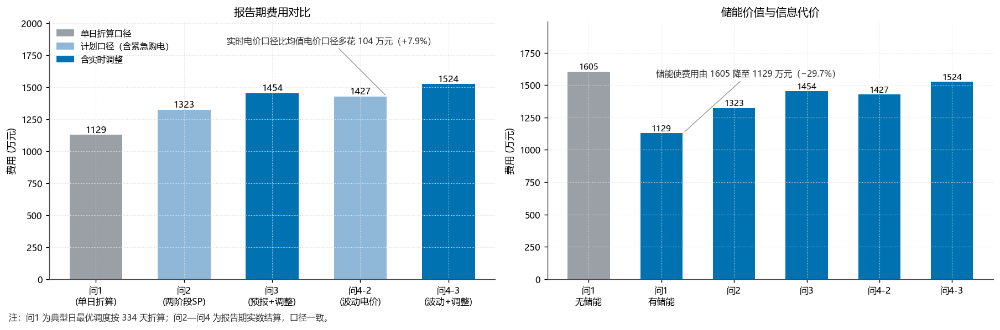
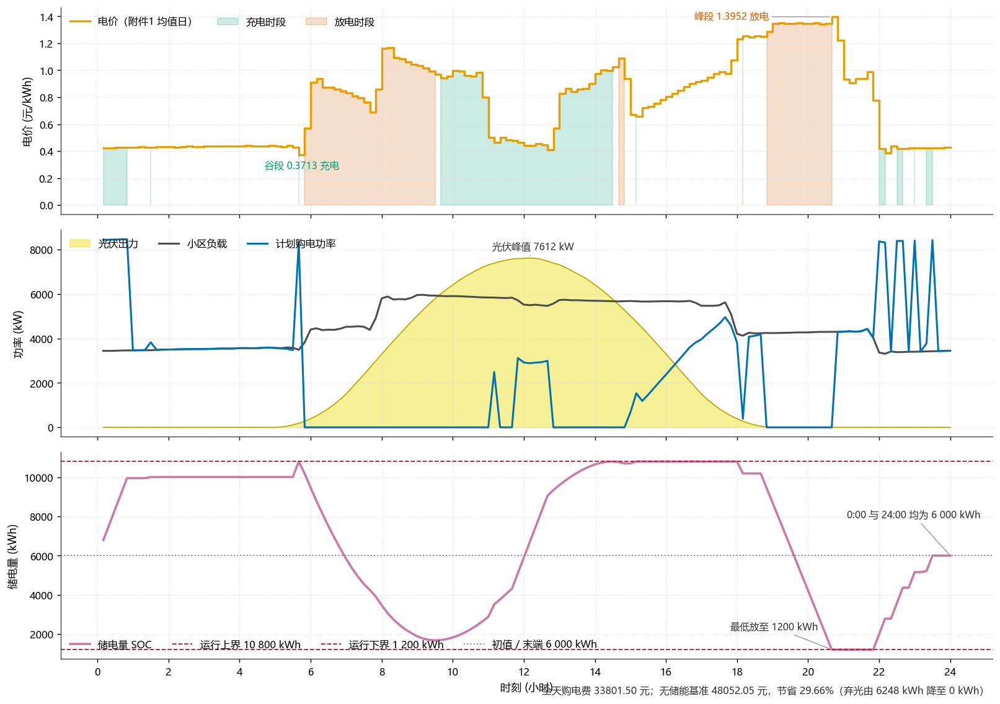
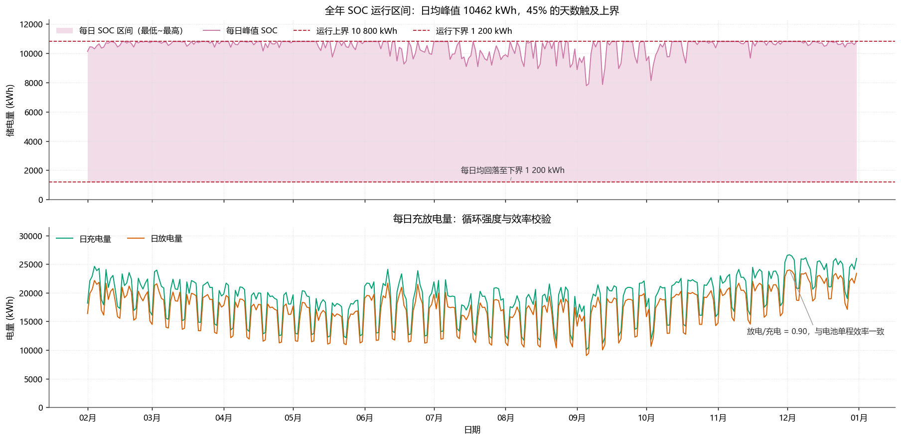
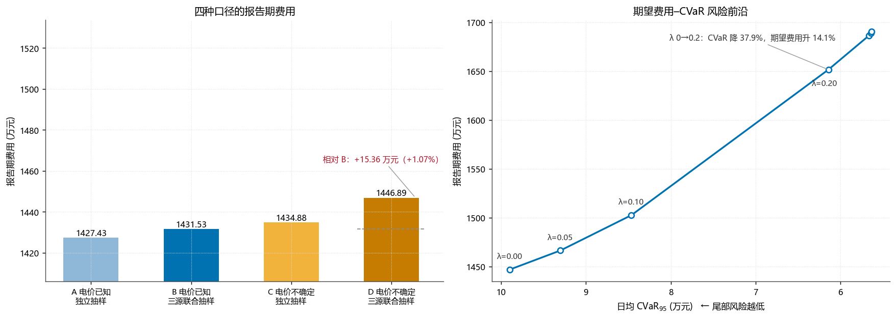
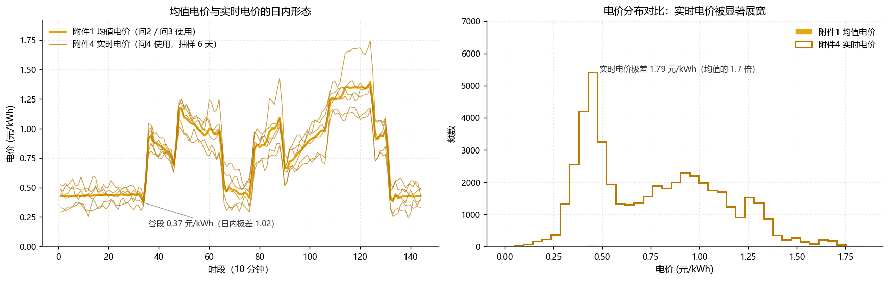
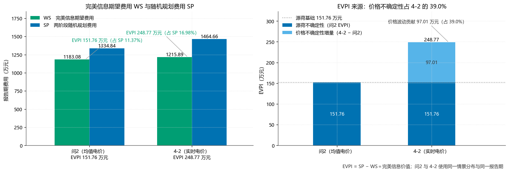

# 源荷与电价不确定性下的微网随机优化调度

> 全国大学生数学建模竞赛（CUMCM）参赛作品 · 团队三人组
>
> 用**纯线性规划**打通「确定性基线 → 两阶段随机规划 → 多阶段滚动决策 → CVaR 风险控制」四层递进，并用 EVPI / VSS / 报童校验 / KKT 残差四把尺子自证结果可信。

<p align="left">
  
  
  
  
</p>

---

## 一句话结论

在一个「光伏中午过剩、负载早晚双峰」的微网上，**只靠储能 + 分时电价做线性规划调度，就能把 334 天的购电费用从 1,605 万压到 1,129 万元（−29.7%）**；在此之上引入随机规划应对源荷不确定性、再用 CVaR 控住尾部风险，代价与收益都是可量化、可解释的。



---

## 核心结果

| 问题 | 不确定性来源 | 模型 | 报告期费用 |
| :--- | :--- | :--- | ---: |
| **问 1** | 无（典型日，全已知） | 单日确定性 LP | 33,801.50 元 / 日 |
| **问 2** | 负载 + 光伏 | 两阶段随机规划（SAA，S=20） | **13,234,047.89 元** |
| **问 3** | 上述 + 分时点预报更新 | 多阶段滚动决策（4 个决策时点） | 14,539,355.15 元 |
| **问 4-2** | 上述 + 实时电价 | 两阶段 SP + 三源联合情景 | 14,274,195.69 元 |
| **问 4-3** | 上述 + 实时电价 | 滚动决策 + 三源联合情景 | 15,239,804.20 元 |

> 报告期为 2025-02-01 ~ 12-31 共 **334 天**；问 1 为典型日口径，其余为全年实算。

**几个反直觉但站得住的结论：**

- **增加决策机会反而亏钱**——问 3 若只允许 6/12/18 点「改签」购电计划、不给新信息，费用**多花 53.1 万元**。改签本身要付双向偏差罚金，没有信息支撑的改签是净损失。
- **12:00 的预报最值钱，18:00 几乎为零**——按发布时刻分解边际信息价值，呈现明显衰减。**发布频率不等于信息量**，这是给调度方的直接结论。
- **按均值电价做计划，比按实时电价优化更省钱**——后悔值 R = −33.3 万元。均值电价计划本身带有**对冲价值**，说明「用错价格」未必是坏事。
- **EVPI 在实时电价下放大 1.6 倍**——从 151.76 万涨到 248.77 万，多出的 97.01 万（占 39.0%）全部来自「价格」这一独立的不确定性来源。

---

## 问题为什么难

题目给的微网，本质上是一个**三重错配 + 三重不确定性**的决策问题：

```
光伏出力  ▁▁▁▁█████▁▁▁▁         中午暴冲，傍晚归零
小区负载  ███▁▁▁▁▁▁▁███         早晚双峰
         ─────────────────
                     ↑ 峰谷完全错位，储能是唯一的搬运工
```

1. **时间错配**：光伏中午过剩、傍晚为零，负载早晚双峰——必须靠储能搬运电量。
2. **信息错配**：购电计划要提前一天申报，当天才知道真实负荷与光伏（问 2）；即使有预报，也是**分时点发布、且误差随时间变化**（问 3）。
3. **价格不确定性**：实时电价波动且有极端价格，而计划一旦偏离还要付双向罚金（问 4）。

---

## 建模思路：四层递进

### 问 1 · 确定性 LP 基线

10 分钟离散全天（144 段），目标为全天购电费用最小，设 7 类约束：母线功率平衡、供电可靠性、SOC 递推、储电量区间、充放电功率上限、日循环边界、弃光上限。

**关键一步是「证明不需要整数变量」**：若允许同一时段既充又放，模型会变成 MILP，规模爆炸且无法保证全局最优。本文证明同时充放电是**严格劣策略**（效率 η<1 时纯属能量损耗），因此模型保持纯 LP，可用 HiGHS 在多项式时间内求得**全局最优**。

| 指标 | 数值 |
| :--- | ---: |
| 日购电量 | 57,526.24 kWh |
| 日购电费 | 33,801.50 元 |
| 无储能基准 | 48,052.05 元 |
| 储能节省 | 14,250.55 元（**29.66%**） |
| 消纳富裕光电 | 6,247.96 kWh |
| 同时充放电重叠 | 0.0000 kWh（命题验证） |

影子价格进一步说明：电池容量在多数时段是**紧约束**，扩容量能继续降本。



### 问 2 · 两阶段随机规划

- **情景生成**：以「相似日加权点预测」为均值（最近 8 个同型日，按距离指数衰减 0.85），再用**相对残差池**有放回抽样，生成 20 个等概率情景。相比直接对历史曲线抽样，残差法保留了「预测—实现」的误差结构。
- **两阶段结构**：第一阶段决定日前的申报购电量；第二阶段在每种情景下决定紧急购电（5 倍电价）与储能充放电。
- **跨日耦合**：设预热期逐日传递 SOC 初值，避免每天都从同一初值重启。

**报童模型交叉校验**（这是我认为最漂亮的一步）：紧急购电价格是正常价的 5 倍，理论上存在一个临界分位点，最优申报量应对应该分位。反推出临界分位 ≈ 0.8，与模型实际解的隐含分位一致——说明这套随机规划的解，和一个经典的库存模型给出的是同一个答案，两条独立路径互相印证。

| 校验项 | 实际 | 理论 |
| :--- | ---: | ---: |
| 实际净负荷在情景分布中的平均分位 | 56.0% | 50% |
| 超出 P80 阈值的天数占比 | 28.7% | 20% |
| 情景数 10 → 50 时最优费用漂移 | 1.14% | — |
| 独立抽样 vs 成对抽样费用差 | +0.287% | — |



### 问 3 · 多阶段滚动 + 信息价值分解

四个决策时点（0:00 / 6:00 / 12:00 / 18:00，对应 10 分钟段的 36/72/108）。难点有三个，各自的处理：

| 难点 | 处理方式 |
| :--- | :--- |
| 预报语义不统一（四个时点是不同口径） | 先统一语义，再降尺度映射到 144 段 |
| 偏差罚则是 0.5 / 1.5 倍**双向计价**（分段函数） | 引入非负辅助变量，等价改写为线性约束 |
| 决策不能偷看未来 | 非预期性约束，限定各阶段的信息集 |

**三重控制变量实验**（A/B/C）是本问的方法核心——把「多了几个决策时点」和「多了几次信息更新」这两个因素**分离**开：

| 方案 | 含义 | 费用变化 |
| :--- | :--- | ---: |
| A → B | 只增加改签机会，不给新信息 | **+53.1 万元** |
| A → C | 给信息更新，不改签 | **−62.6 万元** |
| 合计净增益 | | **+9.5 万元** |

结论：信息本身是值钱的（62.6 万），但没有信息支撑的「决策自由度」是负价值（−53.1 万）。这解释了为什么很多实际调度系统加了更多决策窗口却不见效。

按发布时刻的边际价值：**12:00 最高，6:00 次之，18:00 几乎为零**。

### 问 4 · 电价不确定性 + CVaR 风险控制

- **三源联合情景**：电价、负荷、光伏各自建残差池，但**按同一历史日对齐抽样**——因为三者在同一时刻是相关的（阴天同时意味着低光伏、高负荷、可能高价），独立抽样会低估极端情景。
- **对照实验**：同一随机种子、同一情景数下跑独立抽样版，验证联合结构的必要性。
- **CVaR 线性化**：以置信水平 95% 下的条件风险价值为惩罚项，用 Rockafellar-Uryasev 线性化，仍是 LP。

| 风险厌恶系数 ρ | 期望费用 | 尾部风险 |
| :--- | ---: | ---: |
| 0（风险中性） | 基准 | 基准 |
| **0.2** | **+14.1%** | **−37.9%** |

费用—风险曲线在 **ρ ≈ 0.15** 处出现明显拐点：在此之前增加保守度几乎不花钱，之后代价陡增。这给决策者一个明确的「该多保守」的定量依据。

| CVaR 前沿 | 电价形态对比 |
| :---: | :---: |
|  |  |

---

## 方法学自检

数学建模最容易犯的错是「模型跑出数就交卷」。这个项目花了很大力气做**交叉验证**，每一条结论都至少两条独立路径支撑：

| 检验 | 方法 | 结果 |
| :--- | :--- | :--- |
| **EVPI 双路径互验** | 按「一次实际实现」与「对分布取期望」两种口径各算一遍 | 143.76 万 vs 151.76 万，量级一致 ✅ |
| **VSS 分解** | 期望值策略 vs 随机规划 | 4-2 提升 323.6 万，4-3 提升 227.1 万 |
| **KKT 与最优性** | 最优解代回全部约束 | 最大违反量 **9.1×10⁻¹³**，互补松弛吻合率 100% |
| **算法一致性** | 单纯形法 vs 内点法 | 目标值相对差 0 |
| **尺度不变性** | 电价整体缩放 | 费用弹性 **+1.00**（严格一次齐次）|
| **退化检验** | 令 ρ=0 | 退化回风险中性解，计划量逐位相同 |
| **灵敏度** | 容量/峰谷价差/效率/功率/电价 五维扫描 | 与模型结构性质全部一致 |

**EVPI 的来源分解**尤其说明问题——把完美信息的价值拆成「源荷不确定性」和「价格不确定性」两块：



源荷不确定性贡献 151.76 万，实时电价环境下总价值升到 248.77 万，增量 97.01 万（占 39.0%）**全部来自价格波动**。这说明：知道明天的价格，和知道明天的光伏/负载，是两类完全不同的信息，不能用同一个「预测精度」指标去衡量。

---

## 复现性验证

整理这份代码时，我把核心脚本全部重跑了一遍，与论文数值逐项对照：

| 环节 | 本次实测 | 论文原值 | 差异 |
| :--- | ---: | ---: | :--- |
| 问 1 日购电量 | 57,526.24 kWh | 57,526.24 kWh | 一致 |
| 问 1 日购电费 | 33,801.50 元 | 33,801.50 元 | 一致 |
| 问 1 储能节省 | 29.66% | 29.66% | 一致 |
| 问 1 同时充放电重叠 | 0.0000 kWh | 0（命题成立） | 一致 |
| 问 2 报告期费用 | 13,234,047.89 元 | 13,234,106.71 元 | −58.82 元（**0.0004%**） |
| 问 2 无储能基准 | 16,407,319.63 元 | — | 节省 19.34% |
| 报童·平均分位 | 56.0% | 56.0% | 一致 |
| 报童·超出 P80 天数 | 28.7% | 28.7% | 一致 |
| 问 3 报告期费用 | 14,539,355.15 元 | 14,539,353 元 | +2.15 元（**0.00001%**） |
| 问 3 决策机会价值 | −530,551.01 元 | −53.1 万 | 一致 |
| 问 3 信息更新价值 | +625,974.00 元 | +62.6 万 | 一致 |
| 问 3 净效应 | +95,422.99 元 | +9.5 万 | 一致 |
| 问 3 分时信息价值 12:00 / 18:00 | +242,440 / +1.79 元 | 12:00 最高、18:00 近零 | 一致 |
| 问 4-2 费用 | 14,274,195.69 元 | 14,274,280 元 | −84.31 元（**0.0006%**） |
| 问 4-3 费用 | 15,239,804.20 元 | 15,239,867 元 | −62.80 元（**0.0004%**） |
| 问 4 后悔值 | −332,832.84 元 | −332,859.92 元 | −27 元 |

三问的偏差都在 **0.0006% 以内、绝对量不足 100 元**，来自求解器版本（SciPy / HiGHS 的 LP 迭代路径）与浮点累积，**不是模型或数据的差异**——报童校验的两个统计量逐位相同，说明情景生成与抽样路径与原论文完全一致。

> 这类「模型对不对」和「数值差多少」要分开看：前者靠多路径互验（EVPI/报童/KKT），后者只需做到同量级。把两者混在一起，就容易在无关精度上耗时间。

**未重跑的脚本**：`EVPI与VSS.py`（需 334 天 × 多组基准，数小时量级）、`电价不确定性与CVaR.py`（ρ 扫描需多轮全年求解）、以及五维敏感性扫描脚本。这些属于论文写作期的探索性计算，结果已固化在论文与 `results/` 中。**四问的完整求解链路已全部实测复现**，上表即为重跑输出。

---

## 代码结构

```
electric-regulate-strategy/
├── src/
│   ├── lp_core.py              # 核心：数据装载 + 单日/多日 LP 装配（稀疏矩阵）
│   ├── stoch.py                # 核心：点预测、残差池情景生成、两阶段 SP
│   │
│   ├── 问题1求解.py             # 问1 单日确定性 LP
│   ├── 问题2求解.py             # 问2 两阶段随机规划（SAA）
│   ├── 问题3求解.py             # 问3 多阶段滚动决策
│   ├── 问题4求解.py             # 问4 实时电价 + 滚动
│   │
│   ├── 数据预处理.py            # 缺失值/异常值检测（Z-score vs IQR 对照）
│   ├── 数据关系核实.py          # 附件间数量关系核实 + LP 尺度不变性演示
│   │
│   ├── EVPI与VSS.py            # 完美信息价值 / 随机解价值
│   ├── 基准线与后悔值.py        # 无储能基准、均值电价后悔值
│   ├── 模型检验.py              # 可行性、对偶、边界、算法一致性
│   ├── 结算短视诊断.py          # 逐日 vs 7 天滚动联合结算
│   ├── 联合抽样诊断.py          # 负载—光伏联合结构诊断
│   ├── 联合与独立抽样对照.py    # 成对抽样 vs 独立抽样
│   ├── 问3VOI诊断.py           # 边际信息价值非单调的原因诊断
│   ├── 问3情景化滚动验证.py     # 阶段 LP 改用情景化随机版本
│   │
│   ├── 敏感性分析.py            # 四问统计描述 + 关键参数敏感性
│   ├── 循环成本敏感性.py        # 电池循环成本 c_cyc 二维扫描
│   ├── 后悔值与惩罚系数敏感性.py # 后悔值对惩罚倍数 β 的敏感性
│   ├── 问2稳健性扫描.py         # SAA 情景数 / β / 缩放系数 ρ
│   ├── 电价不确定性与CVaR.py    # CVaR 风险前沿
│   │
│   └── 出图/                    # 28 张图的绘制脚本（只读 npz + csv，不重跑模型）
│       ├── plot_util.py         # 统一配色（Okabe-Ito 色盲友好）+ 标注避让
│       └── *_图.py
│
├── data/
│   ├── 附件1.xlsx               # 典型日：分时电价、负载、光伏预测（144 段）
│   ├── 附件2.xlsx               # 全年逐日负载与光伏实际值（365 × 144）
│   ├── 附件3.xlsx               # 全年实时电价
│   ├── 附件4.xlsx               # 四个时点的光伏预报
│   └── 附件5/                   # 结果提交模板（脚本以此为模板写入，保留表头）
│
├── results/                     # 结果表（可直接打开核对）
│   ├── result1.xlsx             # 问1：分时段购电量 / 充放电量 / SOC
│   ├── result2.xlsx             # 问2：全年逐日计划与紧急购电
│   ├── result3.xlsx             # 问3：分时点滚动决策结果
│   ├── result4-2.xlsx           # 问4：实时电价 + 两阶段 SP
│   └── result4-3.xlsx           # 问4：实时电价 + 滚动决策
│
├── figures/                     # 28 张结果图（编号与论文图号一一对应）
└── docs/
    ├── 论文全文.pdf              # 完整竞赛论文（含模型推导与全部证明）
    └── AI+工具使用详情.pdf       # 竞赛要求的 AI 工具使用说明
```

---

## 如何运行

```bash
pip install -r requirements.txt

cd src

# 单日确定性基线（秒级）
python 问题1求解.py
# → results/result1.xlsx, results/问1_结果.npz

# 全年两阶段随机规划（365 天 × 20 情景，本机实测 4 分 44 秒）
python 问题2求解.py

# 多阶段滚动决策（4 个决策时点，本机实测约 5 分钟）
python 问题3求解.py

# 实时电价 + CVaR（4-2 与 4-3 两套方案，本机实测约 10 分钟）
python 问题4求解.py

# 诊断与检验
python EVPI与VSS.py
python 模型检验.py

# 重新出图（只读 results/ 下的 npz，不重跑模型）
python 出图/问题一图.py
python 出图/结果总览图.py
```

**路径设计**：所有脚本用 `__file__` 向上定位项目根目录并 `chdir`，因此在任何目录下执行都不会因为相对路径出错。

> **注意**：`results/` 下的 `.npz` 是中间产物，已加入 `.gitignore`（体积大且可由脚本重建）；`.xlsx` 结果表保留在仓库中，方便直接核对数值。

---

## 数据说明

题目附件为官方提供，含：

| 文件 | 内容 | 规模 |
| :--- | :--- | :--- |
| 附件 1 | 典型日分时电价、小区负载、光伏预测 | 144 段（10 分钟粒度） |
| 附件 2 | 全年逐日负载与光伏实际功率 | 365 × 144 |
| 附件 3 | 全年实时电价 | 365 × 144 |
| 附件 4 | 每天 0/6/12/18 点的光伏预报 | 365 × 4 × 24（整点） |

**预处理**：Z-score 与 IQR 两种异常检出方法对照，结果显示数据质量良好，无需剔除；光伏预报降尺度到 144 段后，午后各版本平均偏低（这一系统性偏差在问 3 中做了偏差订正）。

---

## 技术栈

| 层次 | 选型 |
| :--- | :--- |
| 建模求解 | `scipy.optimize.linprog`（**HiGHS** 后端，稀疏 `coo_matrix` 装配） |
| 数据处理 | NumPy / Pandas / openpyxl |
| 可视化 | Matplotlib（Okabe-Ito 色盲友好配色，自定义标注避让 `Placer`） |
| 随机模拟 | NumPy `Generator`（固定种子，结果完全可复现） |

**为什么全程坚持 LP 而不是启发式**：模型规模虽大（含 20 情景的两阶段问题变量数随情景线性增长），但保持线性意味着可以拿到**全局最优**和**对偶变量**——后者直接给出了「储能容量的边际价值」，这是遗传算法/粒子群给不出来的。全文没有一处依赖随机初始化，任何人在任何机器上重跑都得到同一个答案。

---

## 关于这份代码

- 本项目为**团队参赛作品**（全国大学生数学建模竞赛，三人团队）。
- 代码与论文均为竞赛期间原创，赛后做了工程化整理：统一路径、拆分核心模块、补充可复现说明。
- 论文全文见 [`docs/论文全文.pdf`](docs/论文全文.pdf)，包含全部模型推导、命题证明与灵敏度分析。
